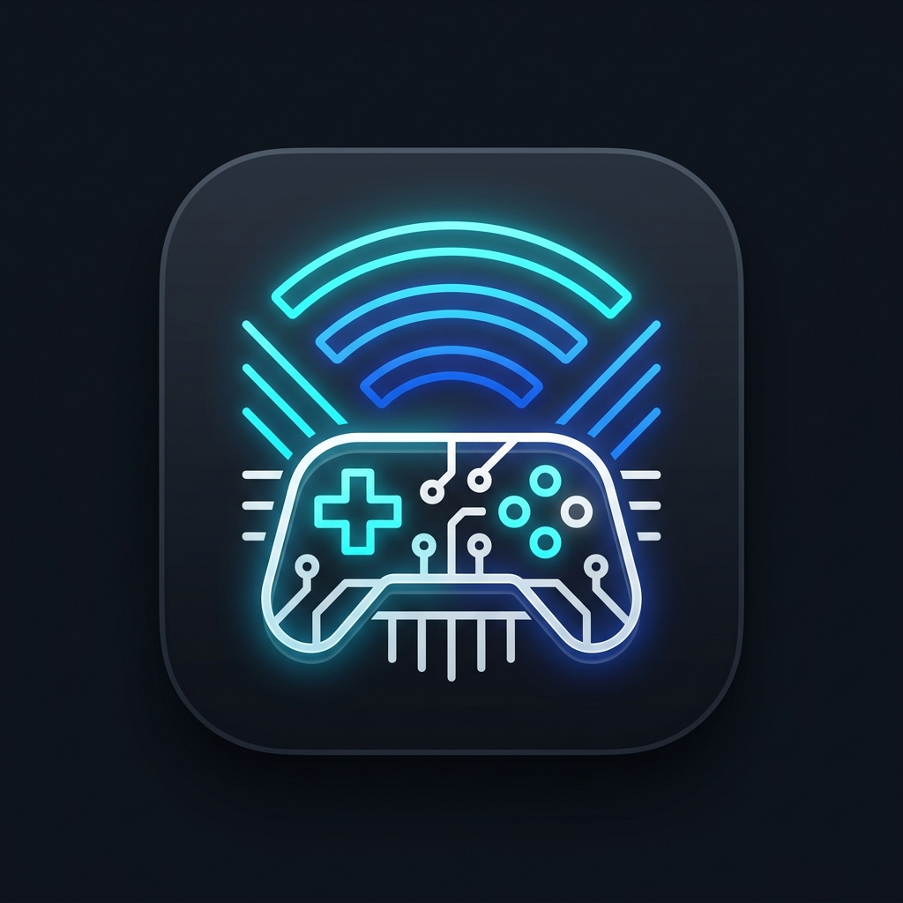

<div align="center">
  
  <h1>RemoteStation</h1>
  <p>Firmware for Arduino Leonardo (ATmega32U4) that decodes 38 kHz infrared remote signals and translates them into USB Human Interface Device (HID) keyboard keystrokes for Sony PlayStation 4 navigation and media playback.</p>

  <p>
    <a href="https://github.com/AtaCanYmc/RemoteStation/actions/workflows/ci.yml"></a>
    <a href="https://github.com/AtaCanYmc/RemoteStation/actions/workflows/release-please.yml"></a>
    <a href="LICENSE"></a>
    <a href="https://platformio.org"></a>
  </p>
</div>

---

## Table of Contents

- [Overview](#overview)
- [Hardware Specifications](#hardware-specifications)
- [Wiring and Pinout](#wiring-and-pinout)
- [System Architecture](#system-architecture)
- [Application Profiles and Mode Switching](#application-profiles-and-mode-switching)
- [Key Mapping Table](#key-mapping-table)
- [Quick Start](#quick-start)
- [Technical Documentation](#technical-documentation)
- [Repository Structure](#repository-structure)
- [Governance and Contributing](#governance-and-contributing)
- [License](#license)

---

## Overview

RemoteStation leverages the native USB peripheral of the ATmega32U4 microcontroller to act as a standard USB HID keyboard. When an infrared transmitter sends a command, the firmware decodes the NEC protocol packet, checks the current application profile, and dispatches corresponding keyboard strokes to the PlayStation 4 or host computer with configurable hold and release timings.

---

## Hardware Specifications

| Component / Parameter | Specification | Notes |
| :--- | :--- | :--- |
| Microcontroller | Microchip ATmega32U4 | 8-bit AVR RISC architecture |
| Core Clock | 16 MHz crystal oscillator | Synchronous USB clocking |
| Operating Voltage | 5.0 V DC | Powered directly over USB bus |
| Flash Memory | 28 KB available | 4 KB reserved for USB bootloader |
| SRAM | 2.5 KB internal | Static allocation for IR buffer |
| USB Interface | Native USB 2.0 Full-Speed | HID keyboard descriptor reports |
| IR Receiver Module | VS1838B (or compatible 38 kHz) | Active-low demodulated output |
| Supported IR Protocol | NEC 32-bit format | Address + inverted command structure |

---

## Wiring and Pinout

Connect the 38 kHz IR receiver module to the Arduino Leonardo according to the following wiring schedule:

| Arduino Leonardo Pin | Type | Firmware Identifier | Connected Hardware | Notes |
| :--- | :--- | :--- | :--- | :--- |
| `Pin 2` (PD1) | Digital Input | `RECV_PIN` | IR Receiver Data Out | Captured by `IRrecv` interrupt service routine |
| `Pin 3` (PD0) | Digital Output | `RECV_EN` | IR Receiver VCC / Enable | Set to `HIGH` during `setup()` to power receiver |
| `GND` | Ground | `GND` | IR Receiver Ground | Common system ground return |
| `Micro-USB Port` | USB Bus | Native D+/D- | PlayStation 4 / Host PC | Supplies 5V power and carries HID keyboard reports |

---

## System Architecture

```mermaid
flowchart LR
    Remote["IR Remote (NEC 38 kHz)"] -->|"Infrared Burst"| Sensor["VS1838B Demodulator"]
    Sensor -->|"Demodulated Pulses (Pin 2)"| Leonardo["Arduino Leonardo (ATmega32U4)"]
    
    subgraph Firmware["RemoteStation Firmware"]
        Leonardo -->|"Raw Timing"| Decoder["IRrecv (decode)"]
        Decoder -->|"32-bit Hex Code"| Controller["PlaystationControl"]
        Controller -->|"State & Mode Filter"| Mapper["IRtoHIDmapper"]
        Mapper -->|"Target Keycode & Duration"| HIDEngine["Keyboard.press / delay / releaseAll"]
    end
    
    HIDEngine -->|"USB HID Keyboard Report"| Host["PlayStation 4 / PC"]
```



---

## Application Profiles and Mode Switching

The firmware maintains stateful application contexts to accommodate differing hotkey schemes across media applications.

### Switching Profiles
1. Press the `RADIO_TV` key on the remote.
2. Immediately press a numeric key corresponding to the desired profile:

| Profile Selector | Target Mode | Target Application / Scope |
| :--- | :--- | :--- |
| `RADIO_TV` + `1` | `Youtube` | YouTube application playback and navigation controls |
| `RADIO_TV` + `2` | `Disney+` | Disney+ specific rewind, forward, and mute hotkeys |
| `RADIO_TV` + `3` | `Browser` | PlayStation 4 Internet Browser controls |
| Default | `PS4` | System-wide D-Pad navigation, Enter, and Back buttons |

---

## Key Mapping Table

### System and Navigation Mappings (`PS4` Mode)

| Remote Function | Raw Hex Code | HID Output | Mapped PlayStation Action |
| :--- | :--- | :--- | :--- |
| `UP` | `0x80BF53AC` | `KEY_UP_ARROW` | D-Pad Up |
| `DOWN` | `0x80BF4BB4` | `KEY_DOWN_ARROW` | D-Pad Down |
| `LEFT` | `0x80BF9966` | `KEY_LEFT_ARROW` | D-Pad Left |
| `RIGHT` | `0x80BF837C` | `KEY_RIGHT_ARROW` | D-Pad Right |
| `OK` | `0x80BF738C` | `KEY_KP_ENTER` | Cross (Confirm / Select) |
| `EXIT` | `0x80BFA35C` | `0x08` (Backspace) | Circle (Back / Cancel) |
| `LANG` | `0x80BF609F` | `KEY_ESC` | Circle (Alternative Back) |
| `MENU` | `0x80BFA956` | `KEY_PAUSE` | PlayStation Button (Quick Tap) |
| `ON_OFF` | `0x80BF3BC4` | `KEY_PAUSE` (1000ms) | PlayStation Button (Hold / Power Menu) |
| `FAV` | `0x80BF916E` | `KEY_PRINT_SCREEN` | Share Menu |
| `OPT` | `0x80BF6996` | `KEY_F3` | Options Menu |
| `NUM_0` to `NUM_9` | `0x80BFE11E` - `0x80BF23DC` | `'0'` to `'9'` | Numpad Input |

### Application-Specific Shortcuts

| Mode | Remote Key | Raw Hex Code | HID Keystroke | Function |
| :--- | :--- | :--- | :--- | :--- |
| `Youtube` | `PLAY` | `0x80BF708F` | `0x20` (Space) | Play / Pause |
| `Youtube` | `REWIND` | `0x80BFD02F` | `'J'` | Seek backward 10 seconds |
| `Youtube` | `FAST_FORWARD` | `0x80BF30CF` | `'L'` | Seek forward 10 seconds |
| `Youtube` | `MUTE` | `0x80BF39C6` | `'M'` | Toggle audio mute |
| `Youtube` | `PREV` | `0x80BFA05F` | `KEY_F4` | Previous track / video |
| `Youtube` | `NEXT` | `0x80BFE01F` | `KEY_F5` | Next track / video |
| `Youtube` | `INFO` | `0x80BF0BF4` | `'S'` | Focus search bar |
| `Disney+` | `MUTE` | `0x80BF39C6` | `'M'` | Toggle audio mute |
| `Disney+` | `REWIND` | `0x80BFD02F` | `'O'` | Seek backward |
| `Disney+` | `FAST_FORWARD` | `0x80BF30CF` | `'P'` | Seek forward |
| `Browser` | `INFO` | `0x80BF0BF4` | `KEY_F1` | Address bar focus |
| `Browser` | `SUBT` | `0x80BF31CE` | `KEY_F2` | Toggle full screen |

---

## Quick Start

### 1. Clone and Enter Repository
```bash
git clone https://github.com/AtaCanYmc/RemoteStation.git
cd RemoteStation
```

### 2. Build Firmware
Compile the firmware for the Arduino Leonardo target:
```bash
pio run
```

### 3. Flash to Microcontroller
Connect your Arduino Leonardo via USB and execute:
```bash
pio run --target upload
```

### 4. Monitor Serial Output
Inspect decoded hex codes and debug prints at 9600 baud:
```bash
pio device monitor -b 9600
# Alternatively using Makefile:
make monitor
```

### 5. Web Flasher & Live Console (Browser)
Launch the local web application for browser-based Web Serial monitoring and firmware flashing:
```bash
make web
# Open http://localhost:8080 in Chrome, Edge, or Opera
```

---

## Technical Documentation

Detailed guides and specifications are maintained in the [`docs/`](docs/) directory:

- **[Hardware & Wiring Specification](docs/hardware.md)**: Electrical pinouts, receiver requirements, and decoupling guidelines.
- **[Protocol & Key Mapping](docs/mapping.md)**: NEC 32-bit infrared protocol, state machine mode switching, and custom mapping tutorial.
- **[Troubleshooting Guide](docs/troubleshooting.md)**: Diagnostic steps for unrecognised remote signals, stuck keys, and console detection.

---

## Repository Structure

```text
RemoteStation/
├── .github/
│   ├── ISSUE_TEMPLATE/
│   │   ├── config.yaml
│   │   ├── bug_report.yml
│   │   └── feature_request.yml
│   ├── PULL_REQUEST_TEMPLATE/
│   │   └── pull_request_template.md
│   └── workflows/
│       ├── ci.yml
│       └── release-please.yml
├── assets/
│   └── logo.png
├── docs/
│   ├── README.md
│   ├── hardware.md
│   ├── mapping.md
│   └── troubleshooting.md
├── include/
│   ├── IRtoHIDmapper.h
│   ├── PlaystationControl.h
│   └── RemoteHex.h
├── src/
│   ├── IRtoHIDmapper.cpp
│   ├── PlaystationControl.cpp
│   └── main.cpp
├── web/
│   ├── app.js
│   ├── firmware.hex
│   ├── index.html
│   ├── logo.png
│   └── style.css
├── .editorconfig
├── .gitattributes
├── .gitignore
├── .release-please-manifest.json
├── CONTRIBUTING.md
├── LICENSE
├── Makefile
├── platformio.ini
├── README.md
├── release-please-config.json
└── SECURITY.md
```

---

## Governance and Contributing

- Pull requests and code updates must adhere to the rules outlined in [CONTRIBUTING.md](CONTRIBUTING.md).
- Security policies, vulnerability scopes, and reporting SLAs are documented in [SECURITY.md](SECURITY.md).
- All changes are verified in CI using PlatformIO Core.

---

## License

This project is licensed under the [MIT License](LICENSE).
