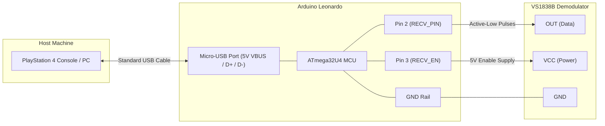

# Hardware and Wiring Specification

[← Back to Documentation Index](README.md) | [← Root README](../README.md)

This document details the physical hardware, pinout assignments, electrical parameters, and receiver timing requirements for RemoteStation.

---

## Microcontroller Specifications

RemoteStation is designed specifically for the **Microchip ATmega32U4** microcontroller (Arduino Leonardo, Pro Micro 5V/16MHz), which features integrated USB 2.0 Full-Speed transceiver hardware. This eliminates the need for external USB-to-UART bridge ICs and enables direct, native USB Human Interface Device (HID) emulation.

| Parameter | Specification |
| :--- | :--- |
| MCU Architecture | 8-bit AVR RISC |
| Clock Speed | 16 MHz external crystal |
| Operating Voltage | 5.0 V DC (USB VBUS powered) |
| Flash Memory | 28 KB available (4 KB reserved for bootloader) |
| SRAM | 2.5 KB (2,560 bytes) |
| USB Controller | Native full-speed USB 2.0 (CDC / HID) |
| Power Consumption | ~50 mA (Leonardo) + ~1.5 mA (IR Receiver) |

---

## Infrared Demodulator Module

The firmware interfaces with standard **38 kHz infrared receiver modules** (e.g. VS1838B, TSOP38238, or equivalent).

| Characteristic | Specification |
| :--- | :--- |
| Carrier Frequency | 38 kHz |
| Supply Voltage | 2.7 V to 5.5 V DC |
| Supply Current | 0.5 mA to 1.5 mA |
| Demodulated Output | Active-Low (pulled HIGH when idle) |
| Internal Filter | Bandpass centered at 38 kHz with AGC |

---

## Pinout and Wiring Table

| Leonardo Pin | Port / Function | Connected Terminal | Description |
| :--- | :--- | :--- | :--- |
| `Pin 2` | `PD1` (INT1) | IR Sensor Data / OUT | Demodulated digital signal line. |
| `Pin 3` | `PD0` (INT0) | IR Sensor VCC | Active HIGH power supply control line. |
| `GND` | Ground | IR Sensor GND | Common circuit ground. |
| `Micro-USB` | Native D+/D- | PlayStation 4 USB Port | Host USB connection for HID reporting and power. |

---

## Wiring Architecture

---

## Electrical Considerations

1. **Decoupling Capacitor**: If using an unshielded breadboard or long wires (> 15 cm) between the Leonardo and the IR receiver, place a `0.1 µF` ceramic capacitor between `VCC` and `GND` adjacent to the receiver to filter USB bus noise.
2. **Current Limiting**: Pin 3 provides 5V logic supply to the receiver. The VS1838B draws less than 2 mA, well within the 40 mA maximum current rating of the ATmega32U4 GPIO pin.
