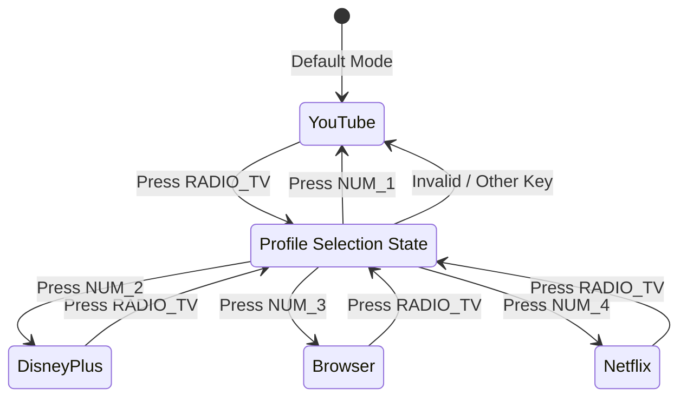

# Protocol and Key Mapping Specification

[← Back to Documentation Index](README.md) | [← Root README](../README.md)

This document describes the infrared transmission protocol, state machine mode switching, and key translation tables implemented in RemoteStation.

---

## Infrared Protocol (NEC 32-bit Format)

RemoteStation decodes the standard **NEC transmission protocol**:

1. **Leading Pulse**: 9 ms leading pulse followed by a 4.5 ms space.
2. **Address Field**: 8-bit address followed by its 8-bit logical inverse.
3. **Command Field**: 8-bit command followed by its 8-bit logical inverse.
4. **Repeat Frame**: When a button is held down, the remote emits a 9 ms pulse followed by a 2.25 ms space and a single end bit (`0xFFFFFFFF`).

In `RemoteStation`, repeat frames (`HOLD`) inherit the last valid decoded command (`lastIR`), ensuring responsive scrolling in menus.

---

## State Machine Profiles

The firmware separates button assignments into system-wide keys and profile-specific hotkeys:



| Profile Identifier | Target Scope | Active Keys |
| :--- | :--- | :--- |
| `MODE_PS4` | System Wide | D-Pad (`UP`, `DOWN`, `LEFT`, `RIGHT`), `OK`, `EXIT`, `MENU`, `FAV`, `OPT`, Numpad (`0`-`9`) |
| `MODE_YOUTUBE` | YouTube App | `PLAY` (Space), `REWIND` ('J'), `FAST_FORWARD` ('L'), `MUTE` ('M'), `PREV` (F4), `NEXT` (F5), `INFO` ('S') |
| `MODE_DISNEY` | Disney+ App | `MUTE` ('M'), `REWIND` ('O'), `FAST_FORWARD` ('P') |
| `MODE_BROWSER` | PS4 Browser | `INFO` (F1 Search), `SUBT` (F2 Fullscreen) |
| `MODE_NETFLIX` | Netflix App | `PLAY` (Space), `MUTE` ('M'), `REWIND` (Left Arrow), `FAST_FORWARD` (Right Arrow), `INFO` ('S') |

---

## Universal System Mappings (`MODE_PS4`)

Universal mappings are evaluated across all modes.

| Key | Hex Code | HID Value | PlayStation 4 Function |
| :--- | :--- | :--- | :--- |
| `UP` | `0x80BF53AC` | `KEY_UP_ARROW` | Directional Pad Up |
| `DOWN` | `0x80BF4BB4` | `KEY_DOWN_ARROW` | Directional Pad Down |
| `LEFT` | `0x80BF9966` | `KEY_LEFT_ARROW` | Directional Pad Left |
| `RIGHT` | `0x80BF837C` | `KEY_RIGHT_ARROW` | Directional Pad Right |
| `OK` | `0x80BF738C` | `KEY_KP_ENTER` | Cross (Select / Confirm) |
| `EXIT` | `0x80BFA35C` | `0x08` (Backspace) | Circle (Back / Cancel) |
| `LANG` | `0x80BF609F` | `KEY_ESC` | Circle (Alternative Back) |
| `MENU` | `0x80BFA956` | `KEY_PAUSE` | PlayStation Button (Quick Tap) |
| `ON_OFF` | `0x80BF3BC4` | `KEY_PAUSE` (1000ms) | PlayStation Button (Hold to open Power Menu) |
| `FAV` | `0x80BF916E` | `KEY_PRINT_SCREEN` | Share Button |
| `OPT` | `0x80BF6996` | `KEY_F3` | Options Button |
| `NUM_0` - `NUM_9` | `0x80BFE11E` - `0x80BF23DC` | `'0'` - `'9'` | Alphanumeric input |

---

## Adding Custom Mappings

To adapt RemoteStation for a different remote control:

1. Open a serial monitor at 9600 baud (`make monitor` or `pio device monitor -b 9600`).
2. Press the target remote button and read the printed 32-bit hex code.
3. Define the code in `include/RemoteHex.h`.
4. Register the binding in `src/IRtoHIDmapper.cpp` within the `buttons` array:
   ```cpp
   {MY_BUTTON_HEX, KEY_TARGET, 50, MODE_PS4, true}
   ```
